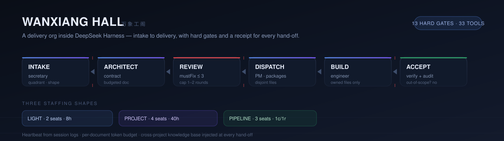

# 万象工阁 · Wanxiang Hall

[](https://github.com/awesome-dsh-plugin/awesome-dsh-plugin)
[](LICENSE)

**English** | [中文](README.zh.md)

> One person's company, five people's output.
> A delivery org inside [DeepSeek Harness](https://github.com/deepseek-ai/deepseek-harness): intake → architect → review → dispatch → build → accept → deliver, with hard gates and a receipt for every hand-off.



Wanxiang Hall turns the workflow of a small software agency into agents that check each other's work, a set of gates that cannot be bypassed, and a panel that shows *who is actually working and where it is stuck*.

Made by **Huanzhan** (company) / **Wanxiang Huanrong** (team).

---

## The three ways a solo agent fails on long work

1. **It looks busy.** Hundreds of tool calls in the session log, `0%` on the panel — because progress is *self-reported* by the agent instead of derived from what it did.
2. **A rejection becomes a full rewrite.** The reviewer says "point 3 is wrong"; the author resends the whole document and quietly changes three other things; the next round is longer than the last. (Real case: 6 rejection rounds, 9 drafts, one document growing from 25K to 60K characters.)
3. **No convergence rule.** What counts as done, how many rounds are allowed, when a human must be called — all of it is left to the user's patience.

## What this plugin does about it

| Layer | Mechanism |
|---|---|
| **Facts** | Heartbeat derived from session-log mtime (`activity.js`: `working / quiet / stale / stuck / dead / unassigned`). All six states are **computed, never stored**. "Running" is not the same as "alive": an agent stuck inside one tool call for two days used to look perfectly healthy. |
| **Rules** | Transitions come from `PIPELINES[shape]` — plain data, per-stage `requires` checks and a `rejectCap`. Missing output, edits outside the declared files, or starting work before the scope is signed are all refused. |
| **Surface** | The panel shows derived facts only: stage, health, work packages, time box, priority quadrant, and the things waiting on *you*. |

---

## Three staffing shapes

| Shape | Seats | Good for | Reject cap | Time box |
|---|---|---|---|---|
| `squad` **light** | architect + delivery engineer | one module, a batch of bugs, a new endpoint | 1 round | 8h |
| `crew` **project** | architect → reviewer → PM → engineer | several modules, cross-platform, packages that need integration | 2 rounds | 40h |
| `line` **pipeline** | architect → PM → engineer (many packages) | homogeneous bulk work | 1 round | none |

The light shape has **no reviewer seat on purpose**: whoever builds the thing reviews the plan (they own the deadline), and code acceptance is automated verification plus a spot-check diff. An independent reviewer only appears in the project shape, where "did we drift from the requirement" cannot be verified by a command.

## Five seats

| id | Title | Job |
|---|---|---|
| `secretary` | Delivery secretary | intake, project setup, answering, proxy signature, spot checks, closing |
| `zhongshu` | Architect | requirement → contract / plan / package breakdown |
| `menxia` | Reviewer *(project shape only)* | structured rejection (`mustFix ≤ 3`) or approval |
| `shangshu` | PM *(called delivery engineer in light, dispatcher in pipeline)* | split packages, dispatch, integrate, quote and settle |
| `executor` | Engineer | change only the files its package declares |

You are the **client**. The signatures only a human can give — scope, extension, closing — are the one thing no agent may fill in for itself.

---

## Four surfaces

- **Intake** — say one sentence to the secretary; importance/urgency quadrant plus a portfolio strip.
- **Workstations** — one seat chain per project; click a seat to jump into that session.
- **Project board** — stage, health, packages, time box, documents, verification, knowledge hits.
- **Knowledge base** — company memory (decision / constraint / pitfall / pattern / tool / glossary / client preference), shared across projects, 3 entries auto-injected into each hand-off.

## Hard gates (headline)

1. Stage changes only via `court_handoff`, and only along edges `PIPELINES` allows.
2. Per-stage `requires`: the document that stage must produce is missing → no hand-off.
3. Rejection cap is per shape; past it the decision goes to the client, not into another loop.
4. A revision after rejection must clear the ledger with `fixes:[1,2]`, and must not grow longer.
5. Documents have a hard budget by kind (contract 6K, plan 12K, package 2K …), overflow returns `BRIEF_TOO_LONG`.
6. Hand-offs send an index and a pointer, not the full text; the receiver reads on demand with `court_read_brief`.
7. Work cannot start before the scope is signed (`court_confirm_scope`), and the scope cannot be signed before a plan exists.
8. Packages are validated for file overlap (`pathsConflict`); overlapping packages must declare `dependsOn`.
9. Before closing, an out-of-scope audit runs: a file outside the declared ownership rejects the closing.
10. Verification commands are **pre-flighted when registered** — a command that cannot even start (`env`, `encoding`) is refused on the spot.
11. The user-action sheet can only be ticked by the secretary or the client; an engineer cannot declare "the user's step is done".
12. When the time box is up, the client picks one of three (cut scope / extend / close); no automatic renewal.
13. Empty-state guard: if the disk still holds projects and the next write would persist an empty state, the write is refused (this is how a real project list got wiped by a "file not found → treat as empty" read).

Full list: [`docs/gates.md`](docs/gates.md) (30 rules).

---

## Install

Package name `dsh-wanxiang-hall`, zero host-side dependencies (Node built-ins only).

**A. From npm** (one line, easiest)

```bash
npm i dsh-wanxiang-hall --prefix <DSH_HOME>/profiles/<profile>
```

**B. Straight from GitHub** (no npm publish needed — npm fetches the repo as a tarball)

```jsonc
// <DSH_HOME>/profiles/<profile>/package.json
{
  "dependencies": { "dsh-wanxiang-hall": "github:hujiajunyu-lab/dsh-wanxiang-hall" }
}
```

**C. Local checkout** (edit and restart; no reinstall)

```bash
git clone https://github.com/hujiajunyu-lab/dsh-wanxiang-hall.git ~/wanxiang-hall
```

```jsonc
// <DSH_HOME>/profiles/<profile>/package.json
{
  "dependencies": { "dsh-wanxiang-hall": "link:~/wanxiang-hall" }
}
```

> **Why local works:** DSH resolves a plugin from the profile's `node_modules`. `link:` creates a directory junction there pointing at the repo. npm is not a runtime requirement — only one way to get the package into `node_modules`.

The package ships `cordis.patch.yml` and `presets/court.patch.yml`, which register:

- an HTTP prefix `/court` (panel data, knowledge base, backups);
- the `court_*` tool set (33 tools);
- five session presets (secretary / architect / reviewer / PM / engineer);
- a system-prompt section injecting the current project index (order 130);
- a watchdog timer (every 10 minutes: liveness, nudge, escalation).

## Where the data lives

| What | Where | Note |
|---|---|---|
| Project state | `<DSH_HOME>/court/court.json` | projects only, no memory |
| Knowledge base | `<DSH_HOME>/court/kb.json` | kept separate: an 8K body inside `court.json` would rewrite the whole file on every hit counter |
| Baselines, verification logs | `<DSH_HOME>/court/baselines/`, `verifications/` | |
| Backup | `$COURT_BACKUP_DIR` or `~/.dsh/court-backups` | plugin source + profile config + state, rolling 10 copies |
| Knowledge export target (optional) | you set it | no default; unset only disables "export to the wiki" |

Environment: `COURT_STATE_DIR` (state dir, for tests), `COURT_BACKUP_DIR`, `COURT_SESSIONS_ROOT` (session-log root used by the heartbeat).

## Develop

```bash
node --check index.js    # syntax
node --test              # 128 unit + regression tests (bare `node --test`, not `node --test test/`)
```

Conventions:

- **Never edit these `.js` files with `Get-Content` / `Set-Content`**: Windows PowerShell reads them as GBK and writes UTF-8, shredding every Chinese string irreversibly (we lost 214 bytes that way).
- On Windows, `npm` / `npm.ps1` may be blocked by execution policy; call `node <npm-cli.js>` or run node directly.
- Tests isolate state through `process.env.COURT_STATE_DIR` and never touch your real projects.

## Roadmap

- [ ] Turn the three-way rejection choice into buttons (today: text + session)
- [ ] Diff view for the document version chain (`revisions` is already stored)
- [ ] Split `client.js` into modules (currently one bundle)
- [ ] Vector retrieval for the knowledge base (today: local scoring + bigram tokens)
- [ ] Real-world validation of the pipeline shape

## License

MIT — see [LICENSE](LICENSE).
